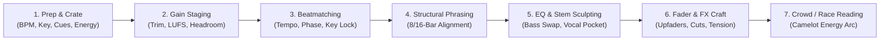

# The Art of DJing & Project Proposal Plan: AI DJ "KINETIX" & Rekordbox 7 Replica

> **Project:** *Rave Racer Remix* (WebGL Prototype & Unity 6 Architecture)  
> **Target Systems:** [`RRR.RekordboxController`](file:///C:/Users/jacks/dev/Rave%20Racer%20Remix/prototype/js/rekordbox-dj.js), [`RRR.RekordboxDeck`](file:///C:/Users/jacks/dev/Rave%20Racer%20Remix/prototype/js/rekordbox-dj.js), [`RRR.RekordboxAnalyzer`](file:///C:/Users/jacks/dev/Rave%20Racer%20Remix/prototype/js/rekordbox-dj.js), [`RRR.CamelotWheel`](file:///C:/Users/jacks/dev/Rave%20Racer%20Remix/prototype/js/rekordbox-dj.js), [`RRR.AudioEngine`](file:///C:/Users/jacks/dev/Rave%20Racer%20Remix/prototype/js/audio-engine.js), and [`RRR.TrackDJController`](file:///C:/Users/jacks/dev/Rave%20Racer%20Remix/prototype/js/dj-jumbotron.js)

---

## Part I: Study of the Art of DJing (Amateur-to-Club Foundations)

At its core, DJing is the art of **maintaining and sculpting continuous musical momentum**. While a playlist merely plays songs end-to-end with dead air or blind crossfades between them, a DJ treats individual tracks as modular building blocks—aligning their rhythms, frequencies, musical keys, and emotional structures into a single uninterrupted journey.

Below is a structured breakdown of the **Seven Pillars of Amateur DJing** and the concrete rules every human DJ learns when moving from bedroom practice to a Boiler Room club set.

---

### 1. Crate Preparation, Track Anatomy & Cue Point Architecture
Before stepping up to the decks, a DJ prepares their crate in **Pioneer rekordbox**:
* **Beatgrid & Downbeat Locking:** Every electronic track is built on a 4/4 time signature (4 beats = 1 bar). If the beatgrid's red **Bar-1 Downbeat marker** is off by even half a beat (e.g., locked to a snare backbeat on Beat 2/4 instead of the kick on Beat 1), every automated loop and sync handoff will trainwreck.
* **Memory Cues vs. Hot Cues:**
  * **Memory Cues (Non-Performance Markers):** Placed at structural landmarks (e.g., *Mix-In Point*, *Breakdown*, *Mix-Out Point*) with a **bar countdown** so the DJ sees *"4 Bars to Drop"* or *"8 Bars to Mix-Out"*.
  * **Hot Cues (`A–H` Performance Pads):** Instantaneous, quantized jump triggers used to skip dead intros, audition drops, or perform live rhythmic edits.
* **Active Loops (Hazard Safety Loops):** In rekordbox, a DJ marks the final 4 or 8 bars of a track's groove as an **Active Loop**. If the DJ gets distracted, the deck automatically traps the outgoing track in a seamless beat loop before it hits the bare outro or dead silence.

---

### 2. Gain Staging & Headroom Management ("Redlining is Not Headlining")
The #1 mistake among amateur DJs is ignoring the **TRIM (Input Gain)** knob at the top of each mixer channel:
* **Why Tracks Vary Wildly in Volume:** A modern Tech House master (e.g., Chris Lake) hits `-6 LUFS`, while an older 90s rave classic or underground Bandcamp dubplate might sit at `-13 LUFS`.
* **Trim vs. Channel Upfader vs. Crossfader:**
  * **TRIM Knob:** Normalizes the track's peak/RMS energy so `0 dB` on the channel VU meter sounds equally loud across all decks.
  * **Channel Upfaders (Volume Faders):** Used to bring the incoming track's level smoothly into the mix.
  * **The "Center-Mix Volume Bump" & Dip Problem:** When two tracks play simultaneously at 100% channel fader volume, correlated bass/mid frequencies sum up (+3 dB to +6 dB spike), or conversely, a naive linear crossfade causes a -3 dB energy hole at the center before the incoming drop hits.

---

### 3. Beatmatching, Phase Alignment & Master Tempo (Key Lock)
Beatmatching requires locking two independent physical variables:
1. **Tempo Matching ($\text{BPM}_A = \text{BPM}_B$):** Adjusting the pitch slider so the *rate* of beats matches.
2. **Phase Alignment ($\phi_A = \phi_B$):** Nudging the outer ring of the CDJ jog wheel (or applying a Phase-Locked Loop micro-pitch bend) so both kick drums strike within `< 5 ms` of each other (preventing hollow comb-filtering/flanging on the kicks) AND aligning **Beat 1 of the 4-beat bar** (`Bar Phase`).

> [!IMPORTANT]
> **The Hidden Amateur Trap: Pitch Shift vs. Master Tempo (Key Lock)**  
> On a turntable or standard Web Audio `AudioBufferSourceNode.playbackRate`, changing speed also changes musical pitch according to:
> $$\Delta \text{semitones} = 12 \cdot \log_2\left(\frac{\text{BPM}_{\text{target}}}{\text{BPM}_{\text{native}}}\right)$$
> If a track at `126 BPM` in `8A (A Minor)` is sped up by `+5.8%` to match a `133.3 BPM` track, its pitch rises by **+1.0 semitone**—turning `8A (Am)` into **`3A (Bbm)` (+7 steps on the Camelot Wheel)**! Without either **Master Tempo (Key Lock time-stretching)** or **Pitch-Aware Camelot Compensation**, a transition that looks harmonic on paper (`8A → 8A`) will clash by a dissonant minor second!

---

### 4. Structural Phrasing & Reverse-Timed Drop Alignment
Electronic dance music (House, UKG, Speed Garage, Techno, Drum & Bass) obeys strict **8-bar (32-beat) and 16-bar (64-beat) phrase geometry**:
* **The Law of Phrasing:** Structural changes—new hi-hat layers, vocal entries, breakdowns, risers, and drops—almost universally occur on Beat 1 of an 8-bar or 16-bar boundary.
* **Reverse-Timed Drop Alignment ("Sweet-Spot Mixing"):**
  * Amateur DJs often press play on Track B's `0:00` intro right as Track A finishes its drop, forcing the dancefloor to sit through 45 seconds of bare drums.
  * Club DJs count backward from Track B's **Main Drop (`Drop 1`)**: if Track B has an 8-bar `PRE_DROP` build-up, the DJ launches Track B's `PRE_DROP` exactly **8 bars before Track A's phrase boundary**. Track A provides the heavy sub-bass foundation while Track B provides the rising tension; on Bar 9 Beat 1, Track A's bass is killed and Track B's Main Drop explodes at full power.

---

### 5. EQ Sculpting, Stem Isolation & Vocal Clash Prevention
The mixer's 3-Band Isolator EQ (`LOW`, `MID`, `HIGH`) and Rekordbox 7's **Real-Time Stems (`DRUMS`, `VOCAL`, `INST`)** are the DJ's primary sculpting tools:
* **Golden Rule #1 — "Two Kicks Cannot Occupy the Same Space":** Low-end sub-bass (`20 Hz – 150 Hz`) carries the highest acoustic energy and longest wavelengths. Layering two full-volume kick/sub-bass lines causes phase cancellation (thin, hollow bass) or muddy clipping. The incoming track must have its `LOW` EQ cut (or killed) until the exact bar of the **Bass Swap**.
* **Golden Rule #2 — Never Layer Competing Vocals ("Vocal Clash"):** The human ear is hyper-sensitive to the `300 Hz – 3.2 kHz` vocal formant band. If Track A has a vocal hook playing while Track B brings in a different vocal verse, the mix immediately sounds like a chaotic trainwreck.
  * **Amateur Fix:** Wait for an instrumental section.
  * **Modern Rekordbox 7 / FLX10 Fix:** Mute the `VOCAL` stem (or carve `-12 dB` on `MID` EQ) on one of the two decks whenever both tracks have active vocal phrases, or float an isolated **Acapella Stem** from Track A over the instrumental drop of Track B.

---

### 6. Fader Choreography & Authentic Club Transition Styles
Different genres and moments call for distinct fader and FX choreography:
1. **Upfaders vs. Crossfader:** House and Techno DJs mix primarily on the **Channel Upfaders** (allowing both tracks to sit at 85–100% in the pocket while EQs do the blending), whereas UKG, Hip-Hop, and DnB DJs use a sharp **Crossfader Curve (`CUT`)** for instant drops and scratches.
2. **Six Signature Boiler Room Transitions:**
   * **The Isolator Bass-Swap (House / Techno):** 16-to-32 bar progressive blend; incoming highs/mids fade in via upfader, followed by an instantaneous `LOW` EQ swap on the phrase downbeat.
   * **The UKG Dub-Echo + Whip Backspin (Speed Garage / 134–144 BPM):** Incoming track builds underneath; on the final 2 beats before the drop, engage a dotted-eighth **Dub Echo** on the outgoing deck, whip the platter backward (**Vinyl Backspin**), and slam the incoming drop.
   * **The Loop-Roll Tightening Riser:** Trap the outgoing track in a `2-beat → 1-beat → 1/2-beat → 1/4-beat` tightening loop while sweeping a High-Pass Filter (`HPF`) + White Noise riser upward, releasing on the incoming drop.
   * **The 3-Stem Acapella Float / Mashup:** Isolate only the `VOCAL` stem of Deck A over the `DRUMS + INST` groove of Deck B (or vice versa), creating a live mashup before fading the vocal out with `SPACE` reverb.
   * **The Echo-Freeze / Fake-Drop Switch (High-Impact Cut):** Sweep High-Pass Filter + 1/2-beat Echo on Deck A, cut Deck A's channel upfader for 2 beats so the echo tail hangs in mid-air, and slam Deck B's drop dry on Beat 1.

---

### 7. Harmonic Mixing & Managing the Set Energy Arc
Using the **Camelot Wheel (`1A–12A` Minor, `1B–12B` Major)** allows a DJ to steer emotional tension deliberately:

| Camelot Move | Example | Musical Interval | Dancefloor / Race Effect |
| :--- | :--- | :--- | :--- |
| **Unison (`0`)** | `8A → 8A` | Same Key | Seamless, hypnotic continuation; zero harmonic tension. |
| **Fifth (`±1`)** | `8A → 9A` / `7A` | Perfect 5th / 4th | Smooth, natural club progression (5 of 7 scale notes shared). |
| **Relative (`A ↔ B`)** | `8A ↔ 8B` | Relative Maj/Min | 100% identical scale notes; shifts mood between Dark (Minor) and Euphoric (Major). |
| **Parallel Tonic** | `8A ↔ 11B` | Same Root (`A min ↔ A maj`) | Dramatic brightness shift while keeping the sub-bass root note identical. |
| **Diagonal (`±1 A↔B`)** | `8A → 9B` / `7B` | Scale Modulation | High-fashion UKG/House color shift. |
| **Energy Boost (`+2` / `+7`)** | `8A → 10A` / `3A` | +2 Whole-Step / +1 Semitone | **Instant adrenaline surge**—used when entering the Final Lap or peak race combat! |

---

## Part II: Implemented 5-Phase Upgrade Summary

| Phase | Target Files | Implemented Features |
| :--- | :--- | :--- |
| **Phase 1: Gain Staging & Upfaders** | [`rekordbox-dj.js`](file:///C:/Users/jacks/dev/Rave%20Racer%20Remix/prototype/js/rekordbox-dj.js), [`index.html`](file:///C:/Users/jacks/dev/Rave%20Racer%20Remix/prototype/index.html), [`style.css`](file:///C:/Users/jacks/dev/Rave%20Racer%20Remix/prototype/css/style.css) | Integrated top-quartile groove/drop loudness (`autoTrimDb`), per-deck `TRIM` sliders, independent `CH1`/`CH2` vertical upfaders, and Dual-Deck Equal-Power compensation. |
| **Phase 2: Harmonic & Vocal Intelligence** | [`rekordbox-dj.js`](file:///C:/Users/jacks/dev/Rave%20Racer%20Remix/prototype/js/rekordbox-dj.js) | Pitch-aware Camelot math (`getEffectivePitchedCamelot`), Harmonic Key Sync (`🎹 KEY` `-2..+2` semitones), `±6.5%` BPM corridor guardrail, per-phrase `hasVocal` formant detector (`🎤 VOCAL`), and automatic Vocal Clash Guard. |
| **Phase 3: Race-Aware Set Director** | [`rekordbox-dj.js`](file:///C:/Users/jacks/dev/Rave%20Racer%20Remix/prototype/js/rekordbox-dj.js), [`main.js`](file:///C:/Users/jacks/dev/Rave%20Racer%20Remix/prototype/js/main.js) | Club Energy Rating (`1–10★`), `SORT: ENERGY ★` crate mode, Race-Aware Camelot scoring (Boiling Rage / Final Lap triggers `+2/+7` Energy Boosts), and 6th transition style (`ECHO_FREEZE_CUT`). |
| **Phase 4: Rekordbox 7 Studio UX & Coach** | [`rekordbox-dj.js`](file:///C:/Users/jacks/dev/Rave%20Racer%20Remix/prototype/js/rekordbox-dj.js), [`index.html`](file:///C:/Users/jacks/dev/Rave%20Racer%20Remix/prototype/index.html) | Red-and-white striped `ACT LP` safety loop at `mixOutSec`, `SLIP` mode with dashed cyan ghost playhead, Memory Cue bar countdown pill (`DROP IN X.XB`), and live `🎓 DJ COACH` educational banner. |
| **Phase 5: Boiler Room Jumbotron & Unity Spec** | [`dj-jumbotron.js`](file:///C:/Users/jacks/dev/Rave%20Racer%20Remix/prototype/js/dj-jumbotron.js), [`Rave Racer Remix - Systems & Unity Architecture.md`](file:///C:/Users/jacks/dev/Rave%20Racer%20Remix/Rave%20Racer%20Remix%20-%20Systems%20&%20Unity%20Architecture.md) | Split-cue headphone pose, mixer rotary knob-twist pose, CDJ backspin blur ring on trackside jumbotrons, and System 3.4 Unity architecture specification. |
